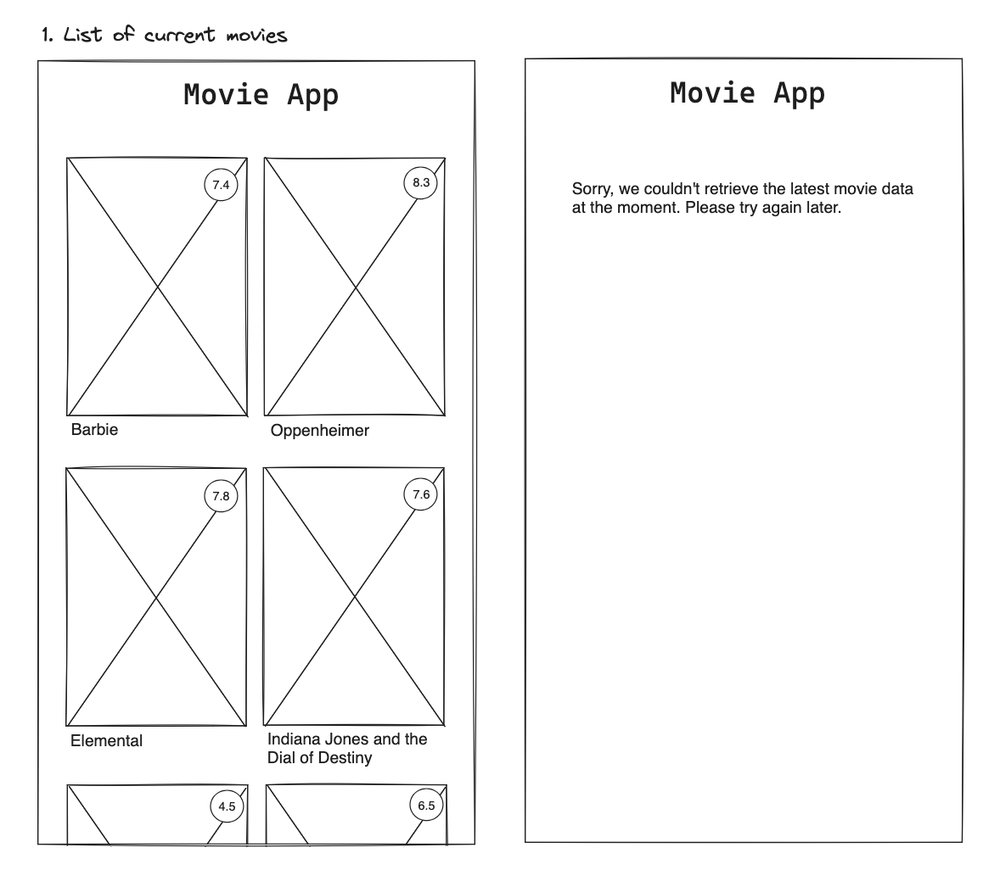

# Title

List of current movies

## Value Proposition

**As a user**  
**I want to see a list of current movies**  
**so that I can decide better on which movie to watch in cinema next**  

## Description

## Acceptance Criteria

- a heading showing the app title
- a list of images of current movies
- the respective movie title
- the respective movie rating
- the list is vertically scrollable
- when there is no movie data, an excuse message is shown

## Tasks

- create a component to display your heading 'Movie App'
- fetch movie data from the following API: [...]
- display a list of movies containing image, title and rating of each movie
- arrange the movie data in two columns
- implement error handling so that when the data can't be fetched, the message 'sorry, please try again later' is displayed
