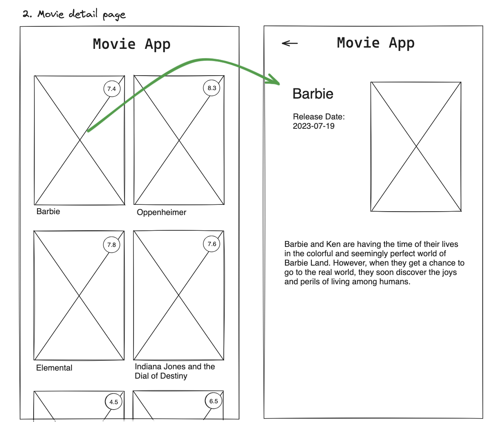

# Title

## Value Proposition

**As a user**  
**I want to be able to see a details page according to each movie** 
**so that I can get further information about the movie I am interested in** `<Purpose>`  

## Description

## Acceptance Criteria

- when clicking on a movie image, a respective details page is displayed
- the details page shows image, title, release date, and further information
- there is a go back button to get back to the homepage

## Tasks

- create a component called movie details
- return the movie title as a headline, the release date value, the movie image and the info text
- to do so fetch further movie data according to the respective id
- save an icon you want to use for the back button in you images folder
- import useRouter from xy
- next to the movie app heading implement a back button that leads you back to the movie list/homepage
