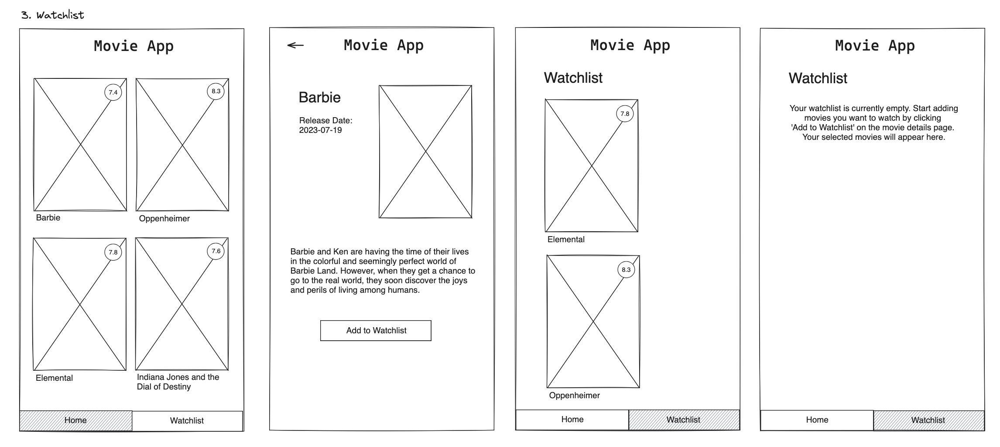

# Title

## Value Proposition

**As a user** 
**I want to be able to add movies to my watchlist** 
**so that I have an overview of the movies I saved for watching next** 

## Description

## Acceptance Criteria

- on the details page there is a button 'add to watchlist'
- clicking on that button adds the respective movie to my watchlist
- there is a navigation bar that leads me 'home' (list of all movies) or to my 'watchlist' (list of marked movies)
- when there are no movies added to the watchlist, a sorry message message is displayed

## Tasks

- in the return statement of your details page component add a button 'add to watchlist'
- create a handleAddMovie function and pass it to the button as onClick prop
- in your handleAddMovie function write the code so that clicking the key value pair 'isWatchlist: true' is added to the respective movie object

- in your pages folder create a watchlist.js
- return a list of all movies containing the key 'isWatchlist' with the value 'true'
- import useState from xy
- create a state to conditionally render either the list of marked movies or (when there a no marked movies) the message 'list is empty, start adding'

- in your component folder create a navigation.js
- import useRouter from xy
- in your navigation component return the respective paths '/' and '/watchlist'
- style the navbar so that the active button is clearly marked visually
